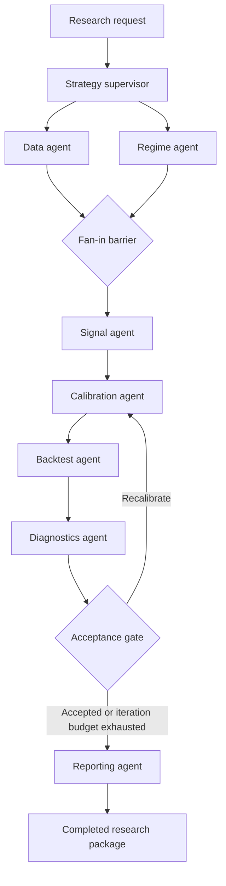

# Production LangGraph Architecture for Enterprise Trading Research

## Executive answer

The proposed workflow is a strong LangGraph use case, but the production design should treat it as a **durable deterministic research pipeline with agentic control**, not as a chain of unconstrained LLM agents. The recommended graph runs market-data preparation and regime classification in parallel from one immutable dataset snapshot, joins both branches before feature generation, separates infrastructure retries from scientific recalibration loops, stores large research artifacts outside graph state, and checkpoints every super-step.

LangGraph models shared state, nodes, and edges directly; multiple outgoing edges execute their destinations in parallel in the next super-step. A list-valued `add_edge(["data_agent", "regime_agent"], "signal_agent")` is the corresponding barrier: the destination waits for all listed nodes to complete.[^1][^2][^3]

The implementation below targets LangGraph 1.2.x. Version 1.2.16 was the current PyPI release on October 16, 2026.[^4]

## Target topology



The loop from diagnostics to calibration is a **domain loop**: it explores another threshold configuration because the research result failed prespecified acceptance criteria. `RetryPolicy`, by contrast, is an **operational retry** for transient failures such as timeouts or temporary service unavailability; retries support configurable attempts, exponential backoff, jitter, and exception predicates.[^5]

## Important correction

Data preparation and regime classification can run in parallel only if both consume an immutable input that already exists. The supervisor should therefore resolve a `dataset_snapshot_id` or raw-manifest URI before fan-out; the data branch validates and transforms that snapshot, while the regime branch independently classifies the same snapshot. If regime classification actually requires the transformed output of the data node, the correct graph is sequential and should not claim parallelism.

## Design decisions

| Concern | Production decision |
|---|---|
| Shared state | Typed metadata and artifact references only; no DataFrames, model objects, open connections, or credentials |
| Large artifacts | Parquet, JSON, HTML, and PDF in object storage; graph state stores URI, hash, schema version, and lineage |
| Parallel work | Data and regime nodes fan out after supervisor and join through `add_edge([...], ...)` |
| Operational failures | Bounded `RetryPolicy` with exception filtering, backoff, jitter, and async node timeouts |
| Research rejection | Explicit diagnostics-to-calibration conditional edge with a hard iteration budget |
| Durability | PostgreSQL checkpointer, stable `thread_id=request_id`, and `durability="sync"` for high-value runs |
| Re-execution | Every external write uses an idempotency key derived from run, node, iteration, and input hashes |
| Numerical work | Deterministic Python/Numba/vectorized services; LLM use is restricted to intent normalization and narrative reporting |
| Reproducibility | Persist data snapshot, strategy version, code commit, dependency lock hash, random seed, costs, and calibration space |
| Observability | Structured events plus traces, latency, retry count, artifact hashes, and domain metrics |

Checkpoints are created at super-step boundaries and can preserve completed writes from successful parallel nodes when another node in the same step fails; this avoids repeating already successful branch work after resumption. Since an interrupted node can start again from the beginning, side effects must be idempotent through upserts, idempotency keys, or read-before-write checks.[^6][^7]

## Project layout

```text
trading-research-graph/
├── pyproject.toml
├── src/trading_graph/
│   ├── __init__.py
│   ├── state.py
│   ├── ports.py
│   ├── nodes.py
│   ├── graph.py
│   ├── runtime.py
│   └── migrate_checkpoints.py
└── tests/
    ├── conftest.py
    └── test_graph.py
```

The graph layer is intentionally thin. Existing market-data, Parquet, DuckDB, calibration, backtest, and reporting modules remain ordinary services behind typed protocols, which keeps them independently testable and prevents LangGraph from becoming the business-logic layer.

## Dependencies

```toml
# pyproject.toml
[project]
name = "trading-research-graph"
version = "0.1.0"
requires-python = ">=3.11"
dependencies = [
  "langgraph==1.2.16",
  "langgraph-checkpoint-postgres>=3.0,<4",
  "psycopg[binary,pool]>=3.2,<4",
  "pydantic>=2.12,<3",
  "structlog>=25,<26",
]

[project.optional-dependencies]
dev = [
  "mypy>=1.18,<2",
  "pytest>=8.4,<9",
  "pytest-asyncio>=1.2,<2",
  "ruff>=0.14,<1",
]

[tool.pytest.ini_options]
asyncio_mode = "auto"
testpaths = ["tests"]

[tool.mypy]
python_version = "3.11"
strict = true

[tool.ruff]
line-length = 100
```

Use a lockfile in the deployed environment rather than relying only on these ranges. The PostgreSQL checkpointer is a separate package intended for production persistence; the official guidance requires running `setup()` initially to create its tables.[^8][^6]

## Typed state

```python
# src/trading_graph/state.py
from __future__ import annotations

from operator import add
from typing import Annotated, Any, Literal, NotRequired, TypedDict


class ArtifactRef(TypedDict):
    uri: str
    sha256: str
    media_type: str
    schema_version: str
    metadata: dict[str, Any]


class AuditEvent(TypedDict):
    node: str
    message: str
    iteration: int


class DiagnosticResult(TypedDict):
    accepted: bool
    reasons: list[str]
    metrics: dict[str, float]


class ResearchInput(TypedDict):
    request_id: str
    strategy_spec_uri: str
    dataset_snapshot_id: str
    universe: list[str]
    start: str
    end: str
    max_iterations: NotRequired[int]


class ResearchOutput(TypedDict):
    status: Literal["completed", "completed_with_warnings"]
    iteration: int
    diagnostics: DiagnosticResult
    dashboard: ArtifactRef
    report_pdf: ArtifactRef


class ResearchState(TypedDict, total=False):
    request_id: str
    strategy_spec_uri: str
    dataset_snapshot_id: str
    universe: list[str]
    start: str
    end: str
    max_iterations: int

    status: str
    iteration: int
    events: Annotated[list[AuditEvent], add]

    market_data: ArtifactRef
    regimes: ArtifactRef
    signals: ArtifactRef
    calibration: ArtifactRef
    backtest: ArtifactRef
    diagnostics: DiagnosticResult
    dashboard: ArtifactRef
    report_pdf: ArtifactRef
```

Reducers determine how concurrent updates are merged. Without a reducer, a state key is overwritten; an `Annotated` reducer such as `operator.add` accumulates updates, which is appropriate for independent audit events emitted by parallel branches. Parallel nodes should otherwise write disjoint state keys to avoid ambiguous last-writer behavior.[^1]

Do not store DataFrames directly in checkpoint state. Although serializers can support additional Python types, large tabular values cause checkpoint growth; current documentation also notes that full channel values are normally written at every super-step. Artifact references make state small, auditable, and portable across worker processes.[^6]

## Service ports

```python
# src/trading_graph/ports.py
from __future__ import annotations

from dataclasses import dataclass
from typing import Any, Mapping, Protocol

from .state import ArtifactRef, DiagnosticResult

StateView = Mapping[str, Any]


class TransientDependencyError(Exception):
    """A retryable outage, timeout, throttling event, or temporary I/O failure."""


class MarketDataPort(Protocol):
    async def prepare(self, state: StateView, *, idempotency_key: str) -> ArtifactRef: ...


class RegimePort(Protocol):
    async def classify(self, state: StateView, *, idempotency_key: str) -> ArtifactRef: ...


class SignalPort(Protocol):
    async def generate(
        self,
        state: StateView,
        *,
        market_data: ArtifactRef,
        regimes: ArtifactRef,
        idempotency_key: str,
    ) -> ArtifactRef: ...


class CalibrationPort(Protocol):
    async def search(
        self,
        state: StateView,
        *,
        iteration: int,
        prior_diagnostics: DiagnosticResult | None,
        idempotency_key: str,
    ) -> ArtifactRef: ...


class BacktestPort(Protocol):
    async def run(
        self,
        state: StateView,
        *,
        iteration: int,
        idempotency_key: str,
    ) -> ArtifactRef: ...


class DiagnosticsPort(Protocol):
    async def analyze(
        self,
        state: StateView,
        *,
        iteration: int,
        idempotency_key: str,
    ) -> DiagnosticResult: ...


class ReportingPort(Protocol):
    async def render(
        self,
        state: StateView,
        *,
        idempotency_key: str,
    ) -> tuple[ArtifactRef, ArtifactRef]: ...


@dataclass(frozen=True)
class AppContext:
    data: MarketDataPort
    regimes: RegimePort
    signals: SignalPort
    calibration: CalibrationPort
    backtest: BacktestPort
    diagnostics: DiagnosticsPort
    reporting: ReportingPort
```

`AppContext` is passed at invocation time and is not placed in durable state. LangGraph nodes may receive a typed `Runtime[Context]`, which exposes runtime context and execution metadata without serializing service objects into checkpoints.[^1]

## Node implementation

```python
# src/trading_graph/nodes.py
from __future__ import annotations

from typing import Any

from langgraph.runtime import Runtime

from .ports import AppContext
from .state import AuditEvent, ResearchState


def _key(state: ResearchState, node: str, iteration: int | None = None) -> str:
    suffix = "base" if iteration is None else str(iteration)
    return f"{state['request_id']}:{node}:{suffix}"


def _event(node: str, message: str, iteration: int) -> list[AuditEvent]:
    return [{"node": node, "message": message, "iteration": iteration}]


async def supervisor(state: ResearchState) -> dict[str, Any]:
    required = (
        "request_id",
        "strategy_spec_uri",
        "dataset_snapshot_id",
        "universe",
        "start",
        "end",
    )
    missing = [name for name in required if not state.get(name)]
    if missing:
        raise ValueError(f"missing required inputs: {', '.join(missing)}")

    max_iterations = int(state.get("max_iterations", 3))
    if not 1 <= max_iterations <= 20:
        raise ValueError("max_iterations must be between 1 and 20")

    return {
        "status": "running",
        "iteration": 0,
        "max_iterations": max_iterations,
        "events": _event("supervisor", "request validated", 0),
    }


async def data_agent(
    state: ResearchState, runtime: Runtime[AppContext]
) -> dict[str, Any]:
    result = await runtime.context.data.prepare(
        state, idempotency_key=_key(state, "data")
    )
    return {
        "market_data": result,
        "events": _event("data_agent", "market data prepared", 0),
    }


async def regime_agent(
    state: ResearchState, runtime: Runtime[AppContext]
) -> dict[str, Any]:
    result = await runtime.context.regimes.classify(
        state, idempotency_key=_key(state, "regime")
    )
    return {
        "regimes": result,
        "events": _event("regime_agent", "regimes classified", 0),
    }


async def signal_agent(
    state: ResearchState, runtime: Runtime[AppContext]
) -> dict[str, Any]:
    result = await runtime.context.signals.generate(
        state,
        market_data=state["market_data"],
        regimes=state["regimes"],
        idempotency_key=_key(state, "signal"),
    )
    return {
        "signals": result,
        "events": _event("signal_agent", "features and signals generated", 0),
    }


async def calibration_agent(
    state: ResearchState, runtime: Runtime[AppContext]
) -> dict[str, Any]:
    iteration = state["iteration"] + 1
    result = await runtime.context.calibration.search(
        state,
        iteration=iteration,
        prior_diagnostics=state.get("diagnostics"),
        idempotency_key=_key(state, "calibration", iteration),
    )
    return {
        "iteration": iteration,
        "calibration": result,
        "events": _event("calibration_agent", "parameter search completed", iteration),
    }


async def backtest_agent(
    state: ResearchState, runtime: Runtime[AppContext]
) -> dict[str, Any]:
    iteration = state["iteration"]
    result = await runtime.context.backtest.run(
        state,
        iteration=iteration,
        idempotency_key=_key(state, "backtest", iteration),
    )
    return {
        "backtest": result,
        "events": _event("backtest_agent", "simulation completed", iteration),
    }


async def diagnostics_agent(
    state: ResearchState, runtime: Runtime[AppContext]
) -> dict[str, Any]:
    iteration = state["iteration"]
    result = await runtime.context.diagnostics.analyze(
        state,
        iteration=iteration,
        idempotency_key=_key(state, "diagnostics", iteration),
    )
    return {
        "diagnostics": result,
        "events": _event("diagnostics_agent", "quality gates evaluated", iteration),
    }


def route_after_diagnostics(state: ResearchState) -> str:
    if state["diagnostics"]["accepted"]:
        return "report"
    if state["iteration"] >= state["max_iterations"]:
        return "report"
    return "recalibrate"


async def reporting_agent(
    state: ResearchState, runtime: Runtime[AppContext]
) -> dict[str, Any]:
    dashboard, report_pdf = await runtime.context.reporting.render(
        state, idempotency_key=_key(state, "report", state["iteration"])
    )
    accepted = state["diagnostics"]["accepted"]
    return {
        "status": "completed" if accepted else "completed_with_warnings",
        "dashboard": dashboard,
        "report_pdf": report_pdf,
        "events": _event("reporting_agent", "research package rendered", state["iteration"]),
    }
```

The idempotency key should additionally incorporate hashes of the strategy specification, data snapshot, code version, and node configuration in a real adapter. The shortened key above keeps the orchestration example readable.

## Graph construction

```python
# src/trading_graph/graph.py
from __future__ import annotations

from collections.abc import Callable

from langgraph.checkpoint.base import BaseCheckpointSaver
from langgraph.graph import END, START, StateGraph
from langgraph.types import RetryPolicy, TimeoutPolicy

from .nodes import (
    backtest_agent,
    calibration_agent,
    data_agent,
    diagnostics_agent,
    regime_agent,
    reporting_agent,
    route_after_diagnostics,
    signal_agent,
    supervisor,
)
from .ports import AppContext, TransientDependencyError
from .state import ResearchInput, ResearchOutput, ResearchState


def retryable(exc: BaseException) -> bool:
    return isinstance(
        exc,
        (TransientDependencyError, ConnectionError, TimeoutError),
    )


IO_RETRY = RetryPolicy(
    max_attempts=4,
    initial_interval=0.5,
    backoff_factor=2.0,
    max_interval=8.0,
    jitter=True,
    retry_on=retryable,
)


def build_graph(
    checkpointer: BaseCheckpointSaver,
    *,
    retry_policy: RetryPolicy = IO_RETRY,
):
    builder = StateGraph(
        ResearchState,
        input_schema=ResearchInput,
        output_schema=ResearchOutput,
        context_schema=AppContext,
    )

    builder.add_node("supervisor", supervisor)
    builder.add_node(
        "data_agent",
        data_agent,
        retry_policy=retry_policy,
        timeout=TimeoutPolicy(run_timeout=180),
    )
    builder.add_node(
        "regime_agent",
        regime_agent,
        retry_policy=retry_policy,
        timeout=TimeoutPolicy(run_timeout=180),
    )
    builder.add_node(
        "signal_agent",
        signal_agent,
        retry_policy=retry_policy,
        timeout=TimeoutPolicy(run_timeout=300),
    )
    builder.add_node(
        "calibration_agent",
        calibration_agent,
        retry_policy=retry_policy,
        timeout=TimeoutPolicy(run_timeout=900),
    )
    builder.add_node(
        "backtest_agent",
        backtest_agent,
        retry_policy=retry_policy,
        timeout=TimeoutPolicy(run_timeout=900),
    )
    builder.add_node(
        "diagnostics_agent",
        diagnostics_agent,
        timeout=TimeoutPolicy(run_timeout=300),
    )
    builder.add_node(
        "reporting_agent",
        reporting_agent,
        retry_policy=retry_policy,
        timeout=TimeoutPolicy(run_timeout=300),
    )

    builder.add_edge(START, "supervisor")

    # Static fan-out: both nodes run in the same next super-step.
    builder.add_edge("supervisor", "data_agent")
    builder.add_edge("supervisor", "regime_agent")

    # Fan-in barrier: signal generation starts only after both complete.
    builder.add_edge(["data_agent", "regime_agent"], "signal_agent")

    builder.add_edge("signal_agent", "calibration_agent")
    builder.add_edge("calibration_agent", "backtest_agent")
    builder.add_edge("backtest_agent", "diagnostics_agent")
    builder.add_conditional_edges(
        "diagnostics_agent",
        route_after_diagnostics,
        {
            "recalibrate": "calibration_agent",
            "report": "reporting_agent",
        },
    )
    builder.add_edge("reporting_agent", END)

    return builder.compile(checkpointer=checkpointer)
```

Per-node timeouts apply to async nodes; a timed-out attempt produces `NodeTimeoutError`, clears writes from the failed attempt, and can then be retried according to `RetryPolicy`. The implementation deliberately avoids a generic error handler that dynamically jumps to a failure node while the same source node also has static edges: current guidance recommends choosing one routing mechanism per node rather than mixing static and dynamic routing.[^5][^1]

Infrastructure exceptions therefore bubble to the API or job runner after retries are exhausted. That boundary marks the external job failed while the checkpoint remains available for a controlled resume. Domain rejection never raises an exception; it follows the explicit recalibration edge.

## PostgreSQL runtime

```python
# src/trading_graph/runtime.py
from __future__ import annotations

from contextlib import asynccontextmanager
from typing import AsyncIterator

from langgraph.checkpoint.postgres.aio import AsyncPostgresSaver

from .graph import build_graph
from .ports import AppContext
from .state import ResearchInput, ResearchOutput


@asynccontextmanager
async def open_graph(
    postgres_dsn: str,
    context: AppContext,
) -> AsyncIterator[tuple[object, AppContext]]:
    async with AsyncPostgresSaver.from_conn_string(postgres_dsn) as checkpointer:
        yield build_graph(checkpointer), context


async def run_research(
    graph: object,
    context: AppContext,
    request: ResearchInput,
) -> ResearchOutput:
    config = {
        "configurable": {"thread_id": request["request_id"]},
        "recursion_limit": 100,
        "tags": ["trading-research"],
        "metadata": {
            "request_id": request["request_id"],
            "dataset_snapshot_id": request["dataset_snapshot_id"],
        },
    }
    return await graph.ainvoke(  # type: ignore[attr-defined,no-any-return]
        request,
        config=config,
        context=context,
        durability="sync",
    )
```

```python
# src/trading_graph/migrate_checkpoints.py
import asyncio
import os

from langgraph.checkpoint.postgres.aio import AsyncPostgresSaver


async def main() -> None:
    async with AsyncPostgresSaver.from_conn_string(
        os.environ["LANGGRAPH_POSTGRES_DSN"]
    ) as checkpointer:
        await checkpointer.setup()


if __name__ == "__main__":
    asyncio.run(main())
```

A checkpointer invocation requires a `thread_id`, which is the primary key used to save and resume a thread. `durability="sync"` persists each checkpoint before the next step and gives the strongest built-in durability at the cost of throughput; `async` is a reasonable option for lower-value exploratory workloads.[^6]

Run checkpoint schema setup as an explicit migration or deployment job, not opportunistically in every worker. When constructing raw psycopg connections manually instead of using `from_conn_string`, the checkpointer package requires autocommit and dictionary rows.[^8]

## Test doubles

```python
# tests/conftest.py
from __future__ import annotations

import asyncio
from typing import Any

import pytest

from trading_graph.ports import AppContext, TransientDependencyError
from trading_graph.state import ArtifactRef, DiagnosticResult


def artifact(name: str) -> ArtifactRef:
    return {
        "uri": f"memory://{name}",
        "sha256": name,
        "media_type": "application/json",
        "schema_version": "1",
        "metadata": {},
    }


class Probe:
    def __init__(self) -> None:
        self.started: set[str] = set()
        self.gate = asyncio.Event()

    async def arrive(self, name: str) -> None:
        self.started.add(name)
        if self.started == {"data", "regime"}:
            self.gate.set()
        await asyncio.wait_for(self.gate.wait(), timeout=1)


class DataFake:
    def __init__(self, probe: Probe, failures: int = 0) -> None:
        self.probe = probe
        self.failures = failures
        self.calls = 0

    async def prepare(self, state: Any, *, idempotency_key: str) -> ArtifactRef:
        self.calls += 1
        if self.calls <= self.failures:
            raise TransientDependencyError("temporary market-data outage")
        await self.probe.arrive("data")
        return artifact("market-data")


class RegimeFake:
    def __init__(self, probe: Probe) -> None:
        self.probe = probe
        self.calls = 0

    async def classify(self, state: Any, *, idempotency_key: str) -> ArtifactRef:
        self.calls += 1
        await self.probe.arrive("regime")
        return artifact("regimes")


class SignalFake:
    async def generate(self, state: Any, **kwargs: Any) -> ArtifactRef:
        return artifact("signals")


class CalibrationFake:
    def __init__(self) -> None:
        self.calls = 0

    async def search(self, state: Any, **kwargs: Any) -> ArtifactRef:
        self.calls += 1
        return artifact(f"calibration-{self.calls}")


class BacktestFake:
    def __init__(self) -> None:
        self.calls = 0

    async def run(self, state: Any, **kwargs: Any) -> ArtifactRef:
        self.calls += 1
        return artifact(f"backtest-{self.calls}")


class DiagnosticsFake:
    def __init__(self, accept_on: int = 1) -> None:
        self.accept_on = accept_on
        self.calls = 0

    async def analyze(self, state: Any, **kwargs: Any) -> DiagnosticResult:
        self.calls += 1
        accepted = self.calls >= self.accept_on
        return {
            "accepted": accepted,
            "reasons": [] if accepted else ["walk-forward stability below threshold"],
            "metrics": {"expectancy": 0.1 * self.calls},
        }


class ReportingFake:
    async def render(self, state: Any, **kwargs: Any) -> tuple[ArtifactRef, ArtifactRef]:
        return artifact("dashboard"), artifact("report")


@pytest.fixture
def request() -> dict[str, Any]:
    return {
        "request_id": "test-run",
        "strategy_spec_uri": "memory://strategy",
        "dataset_snapshot_id": "snapshot-001",
        "universe": ["ES"],
        "start": "2020-01-01",
        "end": "2025-12-31",
        "max_iterations": 3,
    }


def make_context(*, data_failures: int = 0, accept_on: int = 1):
    probe = Probe()
    data = DataFake(probe, failures=data_failures)
    regimes = RegimeFake(probe)
    calibration = CalibrationFake()
    backtest = BacktestFake()
    diagnostics = DiagnosticsFake(accept_on=accept_on)
    context = AppContext(
        data=data,
        regimes=regimes,
        signals=SignalFake(),
        calibration=calibration,
        backtest=backtest,
        diagnostics=diagnostics,
        reporting=ReportingFake(),
    )
    return context, probe, data, regimes, calibration, backtest, diagnostics
```

## Graph tests

```python
# tests/test_graph.py
from __future__ import annotations

from copy import deepcopy

import pytest
from langgraph.checkpoint.memory import InMemorySaver
from langgraph.types import RetryPolicy

from trading_graph.graph import build_graph, retryable
from trading_graph.ports import TransientDependencyError
from conftest import make_context


FAST_RETRY = RetryPolicy(
    max_attempts=3,
    initial_interval=0.01,
    backoff_factor=1.0,
    max_interval=0.01,
    jitter=False,
    retry_on=retryable,
)


def config(thread_id: str) -> dict:
    return {"configurable": {"thread_id": thread_id}, "recursion_limit": 50}


@pytest.mark.asyncio
async def test_parallel_fan_out_and_fan_in(request: dict) -> None:
    context, probe, *_ = make_context()
    graph = build_graph(InMemorySaver(), retry_policy=FAST_RETRY)

    result = await graph.ainvoke(
        request,
        config=config("parallel"),
        context=context,
    )

    assert probe.started == {"data", "regime"}
    assert result["status"] == "completed"
    assert result["iteration"] == 1


@pytest.mark.asyncio
async def test_recalibrates_until_diagnostics_accept(request: dict) -> None:
    context, _, _, _, calibration, backtest, diagnostics = make_context(accept_on=2)
    graph = build_graph(InMemorySaver(), retry_policy=FAST_RETRY)

    result = await graph.ainvoke(
        request,
        config=config("loop"),
        context=context,
    )

    assert result["status"] == "completed"
    assert result["iteration"] == 2
    assert calibration.calls == 2
    assert backtest.calls == 2
    assert diagnostics.calls == 2


@pytest.mark.asyncio
async def test_transient_error_is_retried(request: dict) -> None:
    context, _, data, *_ = make_context(data_failures=2)
    graph = build_graph(InMemorySaver(), retry_policy=FAST_RETRY)

    result = await graph.ainvoke(
        request,
        config=config("retry"),
        context=context,
    )

    assert result["status"] == "completed"
    assert data.calls == 3


@pytest.mark.asyncio
async def test_validation_error_is_not_retried(request: dict) -> None:
    invalid = deepcopy(request)
    invalid["max_iterations"] = 0
    context, *_ = make_context()
    graph = build_graph(InMemorySaver(), retry_policy=FAST_RETRY)

    with pytest.raises(ValueError, match="max_iterations"):
        await graph.ainvoke(
            invalid,
            config=config("invalid"),
            context=context,
        )


@pytest.mark.asyncio
async def test_resume_keeps_successful_parallel_write(request: dict) -> None:
    no_retry = RetryPolicy(
        max_attempts=1,
        retry_on=TransientDependencyError,
    )
    context, _, data, regimes, *_ = make_context(data_failures=1)
    graph = build_graph(InMemorySaver(), retry_policy=no_retry)
    run_config = config("resume")

    with pytest.raises(TransientDependencyError):
        await graph.ainvoke(request, config=run_config, context=context)

    result = await graph.ainvoke(None, config=run_config, context=context)

    assert result["status"] == "completed"
    assert data.calls == 2
    assert regimes.calls == 1
```

LangGraph's testing guidance recommends constructing and compiling a fresh graph with a fresh in-memory checkpointer for each test; individual compiled nodes can also be invoked directly, and checkpoint state can be manipulated for partial-path tests. The resume test above verifies the more important production property: after one parallel branch succeeds and the other fails, resumption should not repeat the successful branch's side effect.[^9]

## Additional test layers

| Layer | Required checks |
|---|---|
| Pure unit | Feature formulas, regime labels, execution costs, fills, PnL, drawdown, expectancy, leakage guards |
| Contract | Each service returns a schema-valid artifact reference and correct lineage/hash metadata |
| Graph | Fan-out, fan-in, recalibration routing, iteration cap, retry filtering, resume, output schema |
| Golden research | Frozen dataset snapshot and expected trades/metrics within explicit tolerances |
| Property | No look-ahead, timestamps monotonic, positions bounded, accounting identity holds |
| Failure injection | Data timeout, object-store conflict, corrupted artifact, worker termination, PostgreSQL interruption |
| Performance | Peak memory, branch latency, checkpoint size, artifact throughput, end-to-end run budget |
| Security | URI allow-listing, secret redaction, tenant isolation, artifact authorization, dependency scanning |

Do not use an LLM judge to validate PnL, accounting, statistical calculations, or absence of leakage. Those checks need deterministic assertions. LLM-based evaluation can be useful for report completeness or request-to-spec translation, but it should not determine whether a strategy is statistically valid.

## Research acceptance gate

The diagnostics service should return a machine-readable decision from a versioned policy. A representative policy can require:

- Minimum trade count and exposure coverage.
- Positive out-of-sample expectancy after fees, slippage, and financing.
- Walk-forward stability rather than a single favorable split.
- Controlled drawdown and tail-loss limits.
- Parameter-neighborhood stability rather than a narrow optimum.
- Regime-specific behavior and explicit failure regimes.
- No timestamp leakage, survivorship leakage, or train/test contamination.
- Sensitivity to costs, latency, missing data, and execution assumptions.

The exact thresholds belong in a configuration artifact, not prompts or node source code. The report should show both the selected result and the search budget exhausted to obtain it; otherwise, iterative calibration can conceal multiple-testing risk.

## Operational controls

### Checkpoint policy

Use `request_id` as the stable LangGraph thread identifier and keep a separate immutable run ID if reruns of the same user request are allowed. A resume passes `None` as graph input with the same thread configuration; checkpoint history can also be inspected, replayed, or forked.[^10][^6]

For expensive runs, retain enough checkpoint history to diagnose failures but enforce retention by tenant and age. Keep artifacts under their own lifecycle policy; deleting checkpoints must not silently delete auditable research artifacts unless an explicit cascading policy requires it.

### State security

Input, output, and private state schemas do not automatically redact private channels from all streaming modes; full-value streams can expose internal channels unless output keys are restricted. Therefore, never put credentials, broker tokens, proprietary raw datasets, or unrestricted presigned URLs in state. Store opaque IDs and resolve authorized access inside adapters.[^1]

### Graceful shutdown

Current LangGraph fault-tolerance APIs support cooperative drain at super-step boundaries and later resumption with the same thread. Worker termination handling should request drain on `SIGTERM`, allow the current bounded node attempt to finish, and resume on replacement capacity; enforce a separate hard termination deadline at the container platform.[^5]

### Observability

Emit both technical and research telemetry:

- Technical: run/thread/checkpoint IDs, node attempt, duration, timeout kind, retry count, exception class, checkpoint bytes, artifact bytes.
- Research: universe, snapshot ID, strategy hash, iteration, candidate count, trade count, expectancy, Sharpe-like measures, drawdown, turnover, cost sensitivity, and gate reasons.
- Lineage: code commit, environment lock hash, configuration hash, seed, artifact hashes, and parent artifact IDs.

LangSmith can capture end-to-end traces, production metrics, dashboards, alerts, and evaluation datasets. For regulated or proprietary workloads, deployment and observability can be cloud, hybrid, BYOC, or self-hosted depending on data-residency requirements.[^11][^12][^13][^14]

## Deployment sequence

1. Build adapters around the existing data, regime, signal, calibration, backtest, diagnostics, and reporting modules.
2. Make every adapter idempotent and content-addressed; validate outputs before publishing artifact references.
3. Run PostgreSQL checkpointer setup as a migration.
4. Run unit, contract, graph, golden-data, failure-injection, and resume tests in CI.
5. Start with one worker and `durability="sync"`; verify checkpoint and artifact lineage under deliberate process termination.
6. Add worker concurrency only after measuring memory and I/O pressure from backtests and calibration searches.
7. Enable tracing with strict redaction and tenant tags; alert on retries, exhausted loops, checkpoint growth, and diagnostics rejection rates.
8. Gate releases on frozen-dataset regression results and a replay test of at least one prior production thread.

LangSmith's documented CI/CD pattern supports offline evaluations, preview deployments, quality-gated promotion, online evaluation, and alerting. Whether LangSmith Deployment or an existing Kubernetes/job platform is used, the application boundary should remain the same: durable graph orchestration around deterministic, independently testable research services.[^15]

## Acceptance criteria

The implementation is ready for production only when all of the following are demonstrated:

- Data and regime branches begin concurrently and signal generation starts only after both finish.
- A transient failure is retried; a validation or invariant failure is not.
- After one parallel branch succeeds and its sibling fails, resume does not repeat the successful branch.
- Recalibration terminates on acceptance or the configured iteration budget.
- A process restart resumes from PostgreSQL using the same `thread_id`.
- Re-running a node with the same idempotency key does not duplicate artifacts or external records.
- Checkpoints contain only bounded metadata and artifact references.
- Every result is reproducible from snapshot, strategy, configuration, code, dependency, and seed identifiers.
- Golden-data backtests match expected trades and metrics within declared tolerances.
- Reports disclose rejected diagnostics, exhausted search budget, assumptions, costs, and lineage rather than presenting only the best candidate.

---

## References

1. [Use the graph API - Docs by LangChain](https://docs.langchain.com/oss/python/langgraph/use-graph-api) - With our state, we specify the reducer add operation. This will combine or accumulate values for the...

2. [langgraph/libs/langgraph/langgraph/graph/state.py at main · langchain-ai/langgraph](https://github.com/langchain-ai/langgraph/blob/main/libs/langgraph/langgraph/graph/state.py) - """Add a directed edge from the start node (or list of start nodes) to the end node.

3. [add_edge | langgraph](https://reference.langchain.com/python/langgraph/graph/state/StateGraph/add_edge) - Add a directed edge from the start node (or list of start nodes) to the end node. The key(s) of the ...

4. [langgraph](https://pypi.org/project/langgraph/) - Key dates. PyPI data. Data sourced directly from PyPI's database. Released: Oct 16, 2026. Latest rel...

5. [Fault tolerance - Docs by LangChain](https://docs.langchain.com/oss/python/langgraph/fault-tolerance) - If the graph is interrupted or the process crashes after a node fails but before the handler complet...

6. [Checkpointers - Docs by LangChain](https://docs.langchain.com/oss/python/langgraph/checkpointers) - LangGraph checkpointers save graph state as checkpoints at each step, enabling persistence, human-in...

7. [Graph API overview - Docs by LangChain](https://docs.langchain.com/oss/python/langgraph/graph-api) - Reducers are key to understanding how updates from nodes are applied to the State . When you compile...

8. [langgraph-checkpoint-postgres](https://pypi.org/project/langgraph-checkpoint-postgres/) - What is this? This library provides a Postgres implementation of LangGraph's checkpoint saver. Use i...

9. [Test - Docs by LangChain](https://docs.langchain.com/oss/python/langgraph/test) - This guide covers some useful patterns you can use when writing unit tests. a useful pattern is to c...

10. [Use time-travel - Docs by LangChain](https://docs.langchain.com/oss/python/langgraph/use-time-travel) - Copy page Overview LangGraph supports time travel through checkpoints: using the specified node's (i...

11. [LangSmith Observability - Docs by LangChain](https://docs.langchain.com/langsmith/observability) - Traces are the record of what your agents did in production. Use them to debug failures, monitor qua...

12. [Set up LangSmith - Docs by LangChain](https://docs.langchain.com/langsmith/platform-setup) - Set up LangSmith for observability, evaluation, and prompt engineering. LangSmith offers Cloud, Brin...

13. [LangSmith Evaluation - Docs by LangChain](https://docs.langchain.com/langsmith/evaluation) - Monitor production quality in real-time from the Observability tab. All options include observabilit...

14. [Hybrid - Docs by LangChain](https://docs.langchain.com/langsmith/hybrid) - Deploy your agent to an Agent Server running in your infrastructure. Send the agent's traces to Lang...

15. [Implement a CI/CD pipeline using LangSmith Deployment ...](https://docs.langchain.com/langsmith/cicd-pipeline-example) - This guide demonstrates how to implement a comprehensive CI/CD pipeline for AI agent applications de...

